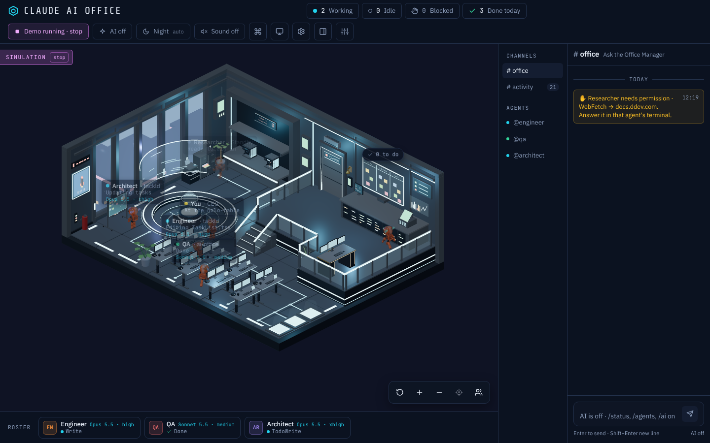
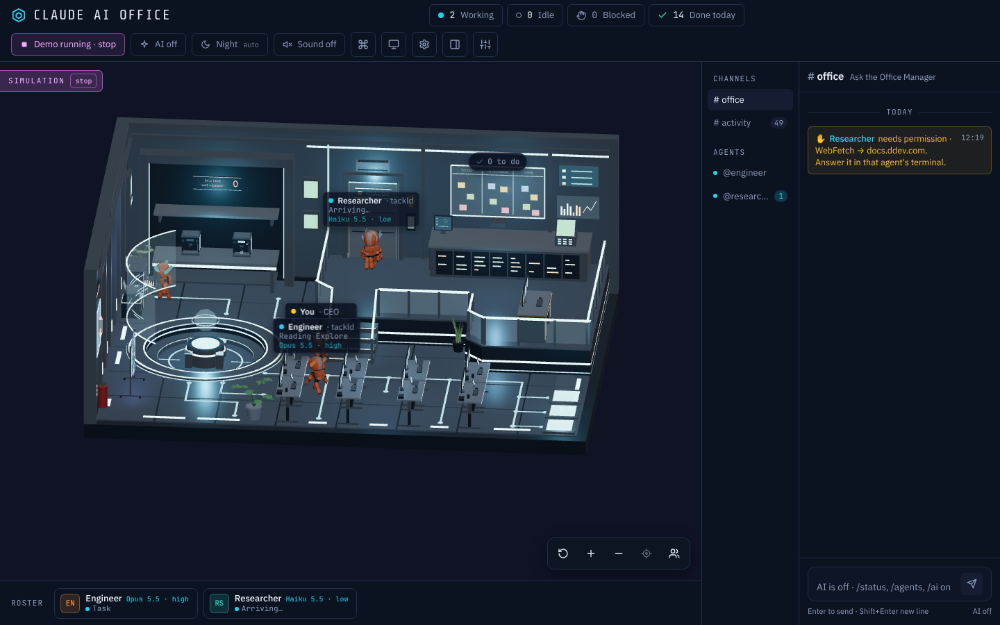
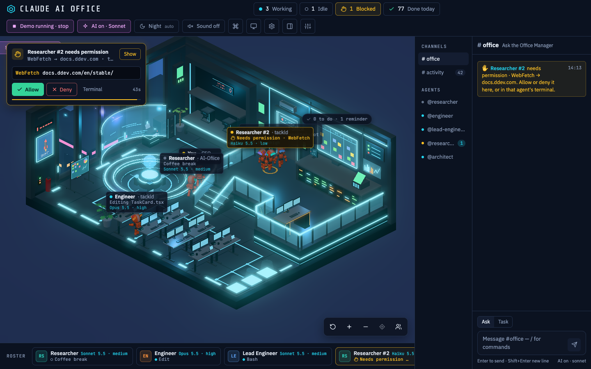

# AI Office

A light, local-only **isometric sci-fi office** where your Claude Code agents show up as robots. They walk in, go to the prop that matches what they're doing (desk, archive, server bank, holo-table, coffee bar…), raise a hand when they need permission, and walk out when they finish.

<p align="center"></p>

- **Plan:** [`docs/PLAN.md`](docs/PLAN.md) · **UI:** [`docs/UI-PLAN.md`](docs/UI-PLAN.md) · **Design:** the "AI Office UI" canvas on claude.ai
- **Features:** a 3D room (limited orbit, day/night, bloom; `?view=2d` for the painted one), path-finding robots, roster and inspector, #activity / #office / per-agent chat, an opt-in AI Office Manager, approving permission prompts from the office, sound, a mission board with reminders, a wallboard mode and a ⌘K palette.

| Orbit the room | Approve a permission prompt |
| --- | --- |
|  |  |

## Quick start

```bash
npm install
npm run install-hooks   # once: adds the hooks to ~/.claude/settings.json (backup made)
npm run dev             # server :3334 + UI at http://127.0.0.1:5273
```

No Claude Code running? Click **Run demo** in the UI, or open `http://127.0.0.1:5273/?sim`.

## How it works

```
Claude Code ──HTTP hooks──▶ office server (Node, :3334) ──WebSocket──▶ browser
                               │  normalise + redact → state machine → SQLite (.data/office.db)
```

The `/hook` endpoint always answers `200` straight away with an empty body, so the office can never slow down, block, approve or deny anything in a real session. If the server is down, Claude Code carries on normally.

## Run it

Requires Node **22.18+** (24 recommended): the server runs its TypeScript directly, with no build step.

### Local

```bash
npm install
npm run install-hooks        # once: adds the hooks to ~/.claude/settings.json (with a backup)
npm run dev                  # server :3334 + Vite UI http://127.0.0.1:5273 (VITE_PORT overrides; 5173 is DDEV's)
```

### DDEV

```bash
ddev start                                                     # server + Vite run as DDEV daemons
npm run install-hooks -- --url http://ai-office.ddev.site:3334/hook   # on your Mac, not in the container
open https://ai-office.ddev.site:5173
```

### Demo without Claude Code

Click **Run demo** in the UI, or start the server with `--sim` (`OFFICE_SIM=1`). Demo agents are marked as a simulation.

## Hooks

`scripts/install-hooks.mjs` adds HTTP hooks for these events: `SessionStart/End`, `UserPromptSubmit`, `Pre/PostToolUse`, `PostToolUseFailure`, `SubagentStart/Stop`, `Stop`, `Notification`, `PermissionRequest`, `TaskCreated/Completed` and `PreCompact`.

- **Auth:** a shared token from `.data/token` (mode 0600) goes in the `Authorization` header. Use `--env` to read it from `$OFFICE_TOKEN` instead of storing it in settings.
- **Re-running:** the installer is safe to re-run. `npm run uninstall-hooks` removes only the AI Office entries.
- **Privacy:** full tool input is never stored. The server keeps the tool name plus a short, redacted summary: a file basename, a command cut to 60 characters with secrets masked, or a host name.

## Layout

```
apps/server/      Hono + ws + node:sqlite. hooks.ts (normalise/redact), state.ts (agent state machine), sim.ts
apps/web/         Vite + React + Tailwind v4 + zustand. src/scene/props.json = prop positions on the room
packages/shared/  Event, agent and WebSocket message types
scripts/          install-hooks.mjs, build-robot.sh, build-art.py (npm run build:art)
Assets/           room background, original sprites, sci-fi/ restyled sprites
.ddev/            DDEV config
office.config.json  desks, idle/break/charge timers, role rules, AI settings
```

## Using the office

- **Mouse:** drag to pan, wheel to zoom, click a robot to inspect it, double-click to follow it.
- **Keys:** `[` `]` previous/next agent · `Shift+F` follow · `Esc` deselect · `+` `−` zoom · `0` reset view · `C` side panel.
- **URL:** `?agent=<id>` selects an agent · `?helper` layout editor (drag spots, props, walkable areas; Save writes props.json under `npm run dev`) · `?debug` raw state · `?parts` colours the robot's animated segments · `?pose=wave` forces a pose.
- **Chat:** `/` focuses the composer. Slash commands are free: `/status`, `/agents`, `/who <role>`, `/ai on|off`, `/approvals on|off`, `/sim`, `/clear`, `/help`.

## The Office Manager (AI)

Off by default. Turn it on with the **AI** pill in the top bar or `/ai on`. Each question runs one `claude -p --model haiku` call **on the machine running the office server**, using your Claude Code login. It gets only the office state (agents, their recent tool names and the short redacted summaries, recent chat), no tools, no hooks and no MCP servers, and nothing is saved by Claude Code. In a robot's DM it answers as that agent, from that agent's events.

Under DDEV the server runs inside the container, where `claude` isn't installed, so the AI shows as unavailable. Run `npm run dev` on your machine to use it (or point `ai.command` in `office.config.json` at another binary).

## Answering permission prompts from the office

Off by default. When a robot raises its hand, click **Approve from the office…** (or type `/approvals on`). From then on, while an office tab is open, a permission request waits in the office with **Allow**, **Deny** and **Terminal** (send it back to the terminal now). If you don't answer within `approvals.waitSec` (45 s, in `office.config.json`), Claude Code asks in the terminal as usual.

- Re-run `npm run install-hooks` (with your usual options) once after updating: the permission hook needs a longer timeout than the other hooks.
- **Allow really runs the command or edit.** The office shows what is being asked (the command, file or host) before you click.

## Credits

- Character: based on ["Mini Robot"](https://sketchfab.com/3d-models/mini-robot-3454c84d6eff4a9dabbfadbfd1f56524) by [Onur](https://sketchfab.com/onurpearl), licensed [CC BY 4.0](http://creativecommons.org/licenses/by/4.0/). Modified: decimated, textures resized and recompressed, animated. Source in `Assets/mini_robot/` (see its `license.txt`); `npm run build:robot` rebuilds `apps/web/public/models/robot.opt.glb`.
- Inspired by [Claude-Office](https://github.com/W17ant/Claude-Office) (MIT).
